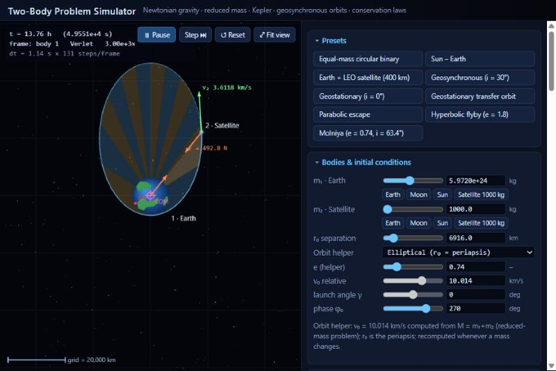
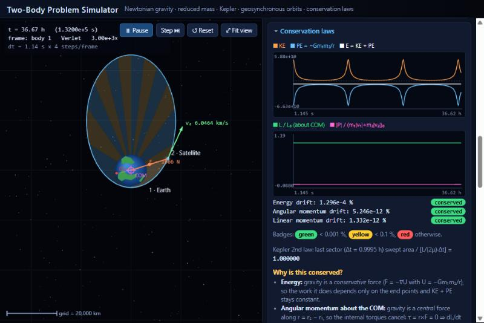
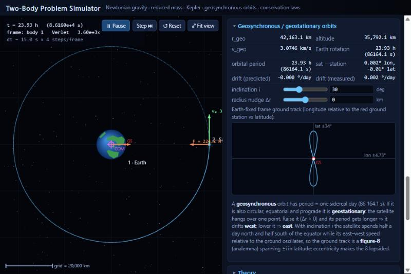

# Two-Body Problem Simulator

An interactive, physically accurate simulator of two point masses under Newtonian gravity, built for a
second-year Mechanical Engineering **Statics & Dynamics** course. It integrates both bodies explicitly in 2D,
shows the reduced-mass (one-body) picture, checks the conservation laws live, and has a dedicated section on
**geosynchronous / geostationary orbits**.



- **Run it online:** https://semsem1313.github.io/two-body-simulator/
- **Run it offline:** download [`two_body_simulator.html`](two_body_simulator.html) and double-click it.

The whole program is **one self-contained file**: HTML + CSS + plain JavaScript drawing on a Canvas 2D.
There are no libraries, no build step, no server and no internet connection needed.

---

## 1. Software requirements and dependencies

| Item | Requirement |
|---|---|
| Browser | Any current desktop or mobile browser: Chrome/Edge 90+, Firefox 90+, Safari 15+ |
| Dependencies | **None.** No libraries, frameworks, packages or CDNs |
| Install / build | None |
| Optional | Python 3 (only if you prefer to serve the file over `http://` instead of opening it directly) |

## 2. How to run the simulation (step by step)

**Option A — online (nothing to download)**
1. Open https://semsem1313.github.io/two-body-simulator/.
2. The simulation starts automatically with the geostationary preset.

**Option B — offline, from this repository**
1. Click the green **Code** button on this page → **Download ZIP**, and unzip it
   (or `git clone https://github.com/semsem1313/two-body-simulator.git`).
2. Double-click `two_body_simulator.html`. It opens in your default browser and starts running.

**Option C — local web server (optional)**
```bash
cd two-body-simulator
python -m http.server 8000
```
then open http://localhost:8000/two_body_simulator.html.

**Check that it works correctly (self-tests)**
1. With the simulator open, press **F12** (or right-click → *Inspect*) and open the **Console** tab.
2. About half a second after loading, a group called *Two-body simulator — self-tests* appears. It should say
   **6/6 passed**. The same results are listed at the bottom of the side panel under *Self-tests*.

## 3. How to use it

1. **Pick a preset** (top of the side panel), or set the masses m₁, m₂ (sliders, text boxes, or the
   Earth / Moon / Sun / 1000 kg satellite buttons) and the separation r₀.
2. **Choose how the initial velocity is set.** *Orbit helper* = circular / elliptical / parabolic / hyperbolic
   computes v₀ for you from the reduced-mass formulas (and recomputes it when a mass changes, so a circular orbit
   stays circular). *Manual* lets you type v₀ and the launch angle γ yourself.
3. **Run it.** Play / Pause / Step / Reset are on the canvas. The time-scale slider goes from 1× to 1,000,000×.
   Switch the integrator (Velocity-Verlet or RK4), the step resolution and the reference frame
   (follow COM / follow body 1 / fixed) under *Simulation controls*. Mouse wheel = zoom, drag = pan,
   *Fit view* = auto-zoom.
4. **Read the physics.** Hover any dashboard value to see its formula. The *Conservation laws* card plots
   KE, PE, E, angular momentum and linear momentum, with drift badges (green / yellow / red). Press
   *Thrust burn* or tick *Drag* to see conservation break, and why.
5. **Geosynchronous orbits.** Load *Geostationary* and watch the satellite stay above the red ground station.
   Move the *radius nudge* slider to make it drift east or west, or the *inclination* slider to draw the
   figure-8 ground track in the Earth-fixed inset. The *Theory* card has all the derivations.

### Screenshots

| Conservation laws (Molniya orbit) | Geosynchronous orbit, i = 30°, after one sidereal day |
|---|---|
|  |  |
| KE and PE swap every orbit, but E = KE + PE stays flat; L and P stay constant. | The period equals the sidereal day, so the satellite returns over the ground station; the inclination traces a figure-8. |

### Presets

| Preset | Bodies | What it shows |
|---|---|---|
| Equal-mass circular binary | 2 × 2×10³⁰ kg, 1 AU apart | both bodies circle the COM at equal radii |
| Sun – Earth | Sun + Earth, e = 0.0167 | T ≈ 365.2 days; the Sun barely moves |
| Earth + LEO satellite | 1000 kg at 400 km altitude | T ≈ 92 min, v ≈ 7.67 km/s |
| Geosynchronous (i = 30°) | 1000 kg at r_geo | period = 1 sidereal day; figure-8 ground track (±30° latitude) |
| Geostationary (i = 0°) | 1000 kg at r_geo | satellite fixed above the ground station |
| Geostationary transfer orbit | perigee 300 km, apogee at GEO | e ≈ 0.727, T ≈ 10.5 h |
| Parabolic escape | v = √(2GM/r) at 500 km | ε ≈ 0, e = 1, the satellite never returns |
| Hyperbolic flyby | e = 1.8, periapsis 12,000 km | starts 110° before periapsis, ε > 0 |
| Molniya | a = 26,600 km, e = 0.74, i = 63.4° | 12 h orbit; very unequal Kepler sectors |

## 4. How the files are organised

```
two-body-simulator/
├── two_body_simulator.html   the simulator (everything: layout, physics, rendering, self-tests)
├── index.html                tiny landing page for GitHub Pages; forwards to the simulator
├── docs/
│   ├── equations.md          every equation, where it is in the code, and how it is verified
│   └── images/               screenshots used in this README
└── README.md                 this file
```

Inside `two_body_simulator.html` the code is split so the physics can be read on its own:

| Part | Lines (approx.) | Contents |
|---|---|---|
| `<style>` | 20–96 | dark theme, responsive layout (side panel stacks below the canvas on phones) |
| `<body>` | 98–283 | canvas, controls, dashboard, graphs, geosynchronous card, Theory card |
| `<script id="physics-module">` | 285–480 | **Physics module**: pure functions in SI units. No drawing and no page access |
| `<script id="app-module">` | 482–1366 | simulation state and stepping loop, UI wiring, dashboard, rendering, self-tests |

Inside `app-module` the sections are numbered: 1 formatting helpers, 2 bodies/presets/parameters,
3 simulation state, 4 UI wiring, 5 dashboard, 6 rendering, 7 main loop, 8 self-tests, 9 start.

## 5. Physics model

- **Bodies:** two point masses in a plane, with masses m₁ and m₂ and drawn radii (used only for drawing and
  collision detection). State vector `s = [x₁, y₁, vx₁, vy₁, x₂, y₂, vx₂, vy₂]`, SI units throughout,
  G = 6.674×10⁻¹¹ N·m²/kg².
- **Force:** Newton's law of gravitation, F = G m₁ m₂ / r², equal and opposite along the line of centres.
  Both bodies are integrated explicitly. The reduced-mass relations are used only to set up the
  initial state and to compute orbital elements for display.
- **Start in the COM frame:** r₁ = −(m₂/M) r and r₂ = (m₁/M) r, with velocities split the same way, so the total
  momentum is exactly zero and the COM is at rest at the origin.
- **Integrators:** Velocity-Verlet (default; symplectic, 2nd order) or classical RK4 (4th order, not symplectic).
  Fixed step dt = (period of a circular orbit at periapsis) / N with N = 100 … 20,000 (default 5,000), and at
  least 4 sub-steps per animation frame.
- **Earth:** M = 5.972×10²⁴ kg, R = 6.371×10⁶ m, rotating once per sidereal day (86,164.1 s).
  r_geo = (G M T² / 4π²)^(1/3) ≈ 42,164 km (altitude ≈ 35,786 km), v_geo ≈ 3.07 km/s.
- **Perturbations (optional):**
  - *Thrust burn* is an external ±10 % Δv impulse on body 2, so E, L and P all change.
  - *Drag* is an internal, equal-and-opposite force pair F₂ = −k m₂ v_rel (the atmosphere belongs to body 1).
    P stays conserved; E and L decay.

The full list of equations, with the function and line where each one is implemented, is in
[`docs/equations.md`](docs/equations.md).

## 6. Verification (built-in self-tests)

The tests run automatically on page load. They call only the physics module and print to the browser console.

| Test | Pass criterion | Result |
|---|---|---|
| T1 Circular binary, Verlet, **1000 orbits** | max \|ΔE/E₀\| < 10⁻⁶ | 8.5×10⁻¹³ |
| T2 Geosynchronous satellite after **one sidereal day** | same angle relative to the rotating Earth (< 10⁻³°) | 1.9×10⁻⁴° |
| T3 Equal-mass binary | \|r₁ − R\| = \|r₂ − R\| at every step | difference 0 (exact symmetry) |
| T4 Numerical period vs T = 2π√(a³/GM) | relative error < 10⁻⁵ | 1.1×10⁻⁶ (e = 0.6), 3×10⁻⁸ (circle) |
| T5 Kepler's 2nd law, 12 equal-time sectors | area = L/(2μ)·Δt within 10⁻⁴ | 3.5×10⁻¹⁴ |
| T6 Verlet vs RK4 (information only) | — | Verlet error flat at ≈3×10⁻³; RK4 error grows ≈46× over 500 orbits |

Values above are from Chrome on Windows; the last digits can differ slightly between browsers.

## 7. Assumptions and limitations

- **Point masses and Newtonian gravity only.** No relativity, no Earth oblateness (J₂), no third bodies, no solar
  radiation pressure.
- **2D dynamics.** Every two-body orbit lies in a plane, so 2D loses nothing for the motion itself. Orbital
  *inclination* only matters relative to Earth's spin axis, so it is applied analytically when the ground track
  in the Earth-fixed inset is computed. The main view always shows the orbital plane from above.
- **Drawn radii** are used only for drawing and for stopping the run on a collision (r < R₁ + R₂). The bodies are
  not treated as rigid spheres.
- **Very high time scales on tight orbits** can hit the per-frame step budget (40,000 steps). The HUD then shows
  “⚠ CPU-capped” and the simulation runs slower than requested; the step size, and so the accuracy, is unchanged.
- The drag model is a teaching device (linear in v_rel with an arbitrary k), not a model of the real atmosphere.

## 8. References

- F. P. Beer, E. R. Johnston, *Vector Mechanics for Engineers: Dynamics*, ch. 12.9–12.13 (central-force motion,
  space mechanics).
- R. C. Hibbeler, *Engineering Mechanics: Dynamics*, §13.7 (central-force motion and space mechanics).
- H. D. Curtis, *Orbital Mechanics for Engineering Students*, ch. 2 (the two-body problem).
- E. Hairer, C. Lubich, G. Wanner, “Geometric numerical integration illustrated by the Störmer–Verlet method”,
  *Acta Numerica* 12 (2003) — why Verlet keeps energy bounded.

## 9. AI-use disclosure

The code and this documentation were written with the help of an AI coding assistant (Claude). The physics,
equations and test results were checked by running the built-in self-tests and the presets in a browser.
